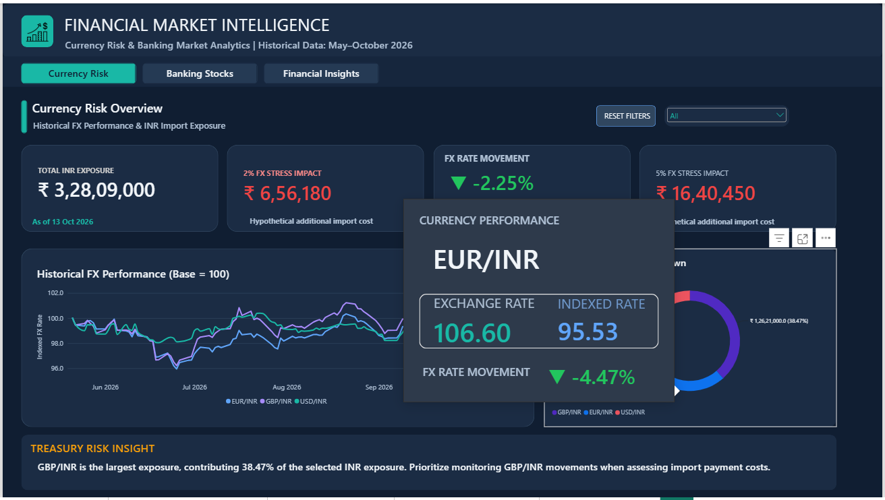
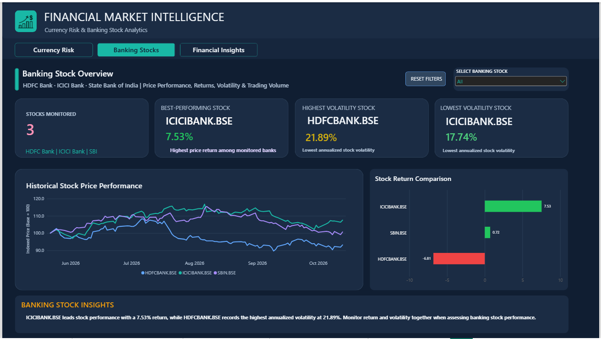
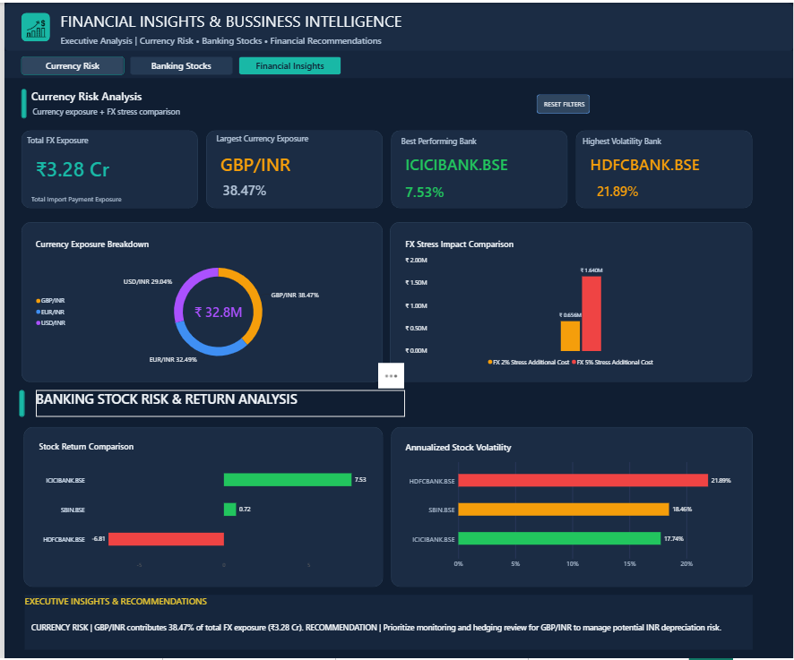
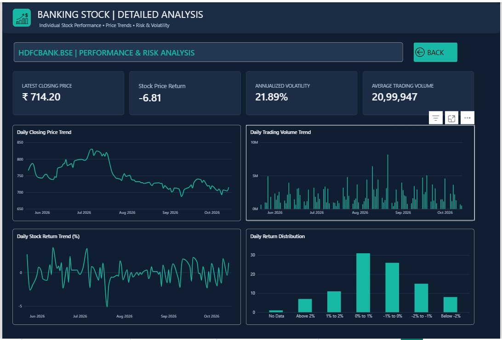

# Financial Market Intelligence & Currency Risk Analytics

**End-to-end Data Analytics Portfolio Project | Python • PostgreSQL • SQL • Power BI • REST APIs**

A practical financial analytics solution that integrates historical and incrementally refreshed foreign-exchange (FX) rates and Indian banking stock market data. It supports **INR-denominated import-payment exposure analysis**, market trend monitoring, banking stock comparisons, and data-quality-controlled reporting.

> **Project status:** Historical ingestion, validation, PostgreSQL loading, exploratory analysis, Power BI reporting, and manual incremental refresh have been implemented and tested. A Windows Task Scheduler configuration was prepared but **has not been activated**. The pipeline is not currently running unattended.

## 1. Business Problem

An India-based treasury or finance team with upcoming foreign-currency import payments needs to understand how changes in USD/INR, EUR/INR, and GBP/INR may affect INR payment obligations. At the same time, a market analyst may want a consolidated view of selected Indian banking equities and their return, volatility, volume, and correlation characteristics.

Without a repeatable process, analysts must manually retrieve market data, clean inconsistent records, compare dates, update reports, and check for anomalies. This project builds a reusable workflow for these tasks.

### Business objectives

- Track USD/INR, EUR/INR, and GBP/INR exchange-rate movements.
- Estimate INR import-payment exposure under exchange-rate changes and stress scenarios.
- Compare the performance and risk of HDFCBANK.BSE, ICICIBANK.BSE, and SBIN.BSE.
- Detect and document missing, duplicate, invalid, out-of-range, and statistically unusual observations.
- Store validated data in PostgreSQL and make analysis available in Power BI.
- Refresh newly available observations without repeatedly inserting historical rows.

**Scope:** Descriptive analytics, monitoring, and scenario analysis. This is **not** a trading system, investment recommendation engine, or guaranteed currency forecast.

## 2. Technology Stack

| Layer | Tools / technologies |
|---|---|
| Data sources | Frankfurter FX API; Alpha Vantage daily stock API |
| Data extraction | Python, HTTP APIs, environment-based configuration |
| Analysis and validation | Python, pandas, Jupyter Notebook, statistical IQR checks |
| Database | PostgreSQL, SQL |
| Reporting | Power BI, Power Query, DAX |
| Orchestration | Python master refresh script, subprocess execution |
| Logging and tests | Python logging, data-quality tests |
| Version control | Git and GitHub |
| Optional scheduling | Windows Task Scheduler — not activated |

See [`requirements.txt`](requirements.txt) for the Python dependencies used by the project.

## 3. Data Sources and Coverage

### Foreign exchange

- **Provider:** [Frankfurter](https://frankfurter.dev/)
- **Pairs:** USD/INR, EUR/INR, GBP/INR
- **Grain:** One observation per currency pair and available observation date
- **Primary uses:** Exchange-rate trends, daily returns, volatility, INR exposure, and stress scenarios

### Indian banking stocks

- **Provider:** [Alpha Vantage](https://www.alphavantage.co/)
- **Symbols:** `HDFCBANK.BSE`, `ICICIBANK.BSE`, `SBIN.BSE`
- **Grain:** One daily OHLCV observation per symbol and trading date
- **Primary uses:** Indexed price comparison, daily returns, annualized volatility, trading-volume analysis, and correlations

### Verified database snapshot

The following figures describe the **validated local database snapshot on November 2, 2026**, not a live count:

| Dataset | Records | Coverage through | Notes |
|---|---:|---|---|
| FX rates | 351 | 2026-10-30 | 117 observations per currency pair |
| Banking stocks | 333 | 2026-10-30 | 111 observations per stock |
| **Combined** | **684** | **2026-10-30** | Historical plus incremental loads |

The November 2 master refresh test completed successfully and inserted **zero new observations** because the APIs did not yet provide newer records. Record counts will change as future refreshes ingest new observations.

## 4. End-to-End Architecture

```text
             EXTERNAL MARKET DATA APIS
               /                   \
      Frankfurter API          Alpha Vantage API
        FX daily rates           Daily stock OHLCV
               \                   /
                \                 /
                PYTHON INGESTION
                       |
                DATA VALIDATION
      Schema | Completeness | Dates | Duplicates
      Domain checks | OHLCV | IQR outlier flags
                       |
                  POSTGRESQL
            fx_rates | banking_stocks
                       |
              SQL BUSINESS ANALYSIS
                       |
                PYTHON EDA
         Trends | Returns | Risk | Exposure
                       |
                  POWER BI
           Interactive financial dashboard
```

An additional **incremental refresh** path queries the latest stored dates, requests newly available API observations, validates them, inserts eligible records, recalculates historical outlier flags, and writes execution logs.

## 5. Data Preparation and Quality Assurance

Validation is a core component of the project rather than a final reporting-only check.

### FX validation

- Confirm expected fields, data types, and supported currency pairs.
- Check for null values, invalid dates, duplicate pair/date combinations, and invalid exchange rates.
- Review observation-date alignment across the three currency pairs.
- Check coverage against the approved analysis period.
- Flag unusual exchange-rate observations using the **1.5 × interquartile range (IQR)** rule.
- Preserve valid observations while documenting flagged outliers for review.

### Banking stock validation

- Confirm required fields and valid stock symbols.
- Check missing values, duplicates, and observation-date coverage.
- Validate positive price and nonnegative volume values.
- Check OHLC consistency (high and low relative to open/close).
- Identify unusual closing-price and volume observations using per-symbol IQR thresholds.
- Review out-of-period records and statistical anomalies separately from invalid records.

**Outlier method:** For a given historical series, `IQR = Q3 − Q1`. Values outside `[Q1 − 1.5 × IQR, Q3 + 1.5 × IQR]` are flagged for review. A statistical outlier is **not automatically a data error** and is not automatically deleted.

### Validated snapshot findings

- FX: **351 rows**; historical IQR review identified **1 GBP-related FX outlier** in the verified snapshot.
- Stocks: **333 rows**; **0 closing-price outliers** and **21 volume outliers** across the three symbols in the verified snapshot.
- The incremental pipeline was rerun without creating duplicate inserts.

Validation artifacts are stored in [`Data/validation/`](Data/validation/), and SQL reconciliation scripts are in [`SQL/`](SQL/).

## 6. PostgreSQL Data Model and SQL Analysis

Validated market observations are loaded into two primary PostgreSQL tables:

| Table | Purpose | Logical grain |
|---|---|---|
| `public.fx_rates` | Historical FX observations and outlier indicators | Date + base currency + quote currency |
| `public.banking_stocks` | Daily banking equity observations and outlier indicators | Date + stock symbol |

SQL files document schema creation, database checks, data reconciliation, and financial business analysis:

- [`SQL/01_database_schema.sql`](SQL/01_database_schema.sql) — schema setup
- [`SQL/02_database_validation.sql`](SQL/02_database_validation.sql) — database validation
- [`SQL/03_fx_data_reconciliation.sql`](SQL/03_fx_data_reconciliation.sql) — FX reconciliation
- [`SQL/04_banking_stocks_reconciliation.sql`](SQL/04_banking_stocks_reconciliation.sql) — stock reconciliation
- [`SQL/05_final_database_validation.sql`](SQL/05_final_database_validation.sql) — final checks
- [`SQL/06_fx_business_analysis.sql`](SQL/06_fx_business_analysis.sql) — FX business questions
- [`SQL/07_banking_stock_business_analysis.sql`](SQL/07_banking_stock_business_analysis.sql) — stock business questions

## 7. Python Exploratory Data Analysis

The analysis notebook [`Python/Notebooks/07_Financial_Data_Analysis.ipynb`](Python/Notebooks/07_Financial_Data_Analysis.ipynb) and exported figures cover:

**FX and currency risk**

- Exchange-rate trends and indexed currency performance
- Daily exchange-rate returns and annualized volatility
- INR import-payment exposure
- Exchange-rate stress scenarios

**Banking stock intelligence**

- Closing-price trends and indexed performance
- Daily returns and annualized volatility
- Trading-volume outliers and average daily volume
- Return correlation heatmaps and pairwise correlations
- Risk/return comparisons

Exported charts are available in [`Python/Visualizations/`](Python/Visualizations/).

## 8. Power BI Dashboard

**Dashboard file:** [`PowerBI/Financial_Market_Intelligence_Dashboard.pbix`](PowerBI/Financial_Market_Intelligence_Dashboard.pbix)

The Power BI reporting layer brings together the processed FX and stock analysis outputs to support exploration of:

- FX performance and currency exposure
- Import-payment scenarios and potential INR cost changes
- Banking stock performance, return, volatility, and volume behavior
- Cross-stock comparisons and correlation

Power BI-ready CSV outputs are stored in [`Data/processed/PowerBI/`](Data/processed/PowerBI/). The dashboard is a **local `.pbix` artifact**; this repository does not claim a published or automatically refreshed Power BI Service dataset.

### Dashboard screenshots

The screenshots below preview the four report pages. They are static images of the Power BI report; open the `.pbix` file in Power BI Desktop to explore its interactive features.

#### Page 1 — Currency Risk Overview



#### Page 2 — Banking Stock Overview



#### Page 3 — Financial Insights



#### Page 4 — Stock Drillthrough



All four screenshots are stored in [`PowerBI/Screenshots/`](PowerBI/Screenshots/).

## 9. Automated Incremental Market Data Refresh

### Why incremental refresh?

Rebuilding the entire history for every update wastes API calls, increases processing time, and risks duplicate records. This project implements **incremental ingestion** with validation, database updates, outlier re-evaluation, and logging.

### Refresh architecture

```text
Python/Scripts/daily_market_refresh.py
                 |
                 v
Python/Scripts/fx_incremental_refresh.py
    -> Read latest FX dates from PostgreSQL
    -> Request new Frankfurter observations
    -> Validate new observations
    -> Insert eligible, nonduplicate rows into fx_rates
    -> Recalculate historical FX IQR outlier flags
                 |
         (only on success)
                 v
Python/Scripts/stock_incremental_refresh.py
    -> Read latest stock dates from PostgreSQL
    -> Request new Alpha Vantage observations
    -> Validate OHLCV and dates
    -> Insert eligible, nonduplicate rows into banking_stocks
    -> Recalculate historical stock IQR outlier flags
                 |
                 v
        Log completion or errors
```

### Pipeline components

| File | Responsibility |
|---|---|
| [`daily_market_refresh.py`](Python/Scripts/daily_market_refresh.py) | Master orchestration; sequentially executes FX and stock refreshes; stops if a subprocess fails |
| [`fx_incremental_refresh.py`](Python/Scripts/fx_incremental_refresh.py) | Fetches, validates, and incrementally loads FX observations; refreshes outlier flags |
| [`stock_incremental_refresh.py`](Python/Scripts/stock_incremental_refresh.py) | Fetches, validates, and incrementally loads stock observations; refreshes outlier flags |
| [`pipeline_logger.py`](Python/Scripts/pipeline_logger.py) | Shared logging support |

### Run the pipeline manually

From the project root, with your virtual environment active:

```powershell
python Python/Scripts/daily_market_refresh.py
```

The master script uses the active Python interpreter to execute the two pipelines in sequence. It reports failures rather than silently continuing to the next pipeline.

**Successful test:** On **November 2, 2026**, the master refresh finished successfully, with no new API observations beyond October 30. The verified local database contained **351 FX + 333 stock = 684 records**. A no-new-data run completed without duplicate inserts.

### Scheduling status

Windows Task Scheduler was explored for a **daily 8:00 PM IST** run, but the task was **not fully activated or verified**. Automatic unattended refresh is therefore **not currently enabled**. To automate it in a Windows environment, create and verify a scheduled task that runs the project's virtual-environment Python executable with `Python\Scripts\daily_market_refresh.py` as its argument and the project root as its working directory. Confirm API quotas, machine availability, and credentials before relying on a schedule.

### Operational considerations

- Alpha Vantage API access is subject to the limits of the configured account/key.
- New observations may not be available on weekends, market holidays, or before provider updates.
- Re-running a refresh should not create duplicate observations.
- Historical IQR flags can change as the sample expands.
- The pipeline updates PostgreSQL; **Power BI refresh is a separate operation** and is not claimed to be automated here.
- Logs may contain operational details; avoid publishing secrets or sensitive local paths.

## 10. Project Structure

```text
Financial_Market_Intelligence_Analytics/
├── .env.example
├── .gitignore
├── README.md
├── requirements.txt
├── Business_Insights/
│   ├── Banking_Stock_Intelligence_Insights.md
│   └── FX_Currency_Risk_Insights.md
├── Config/
│   ├── api_config.py
│   └── db_config.py
├── Data/
│   ├── raw/
│   ├── processed/
│   │   └── PowerBI/
│   └── validation/
├── Logs/
│   └── data_quality_test_results.xml
├── PowerBI/
│   ├── Financial_Market_Intelligence_Dashboard.pbix
│   └── Screenshots/
│       ├── 01_Currency_Risk_Overview.png
│       ├── 02_Banking_Stock_Overview.png
│       ├── 03_Financial_Insights.png
│       └── 04_Stock_Drillthrough.png
├── Python/
│   ├── Notebooks/
│   │   ├── 00_Environment_Test.ipynb
│   │   ├── 01_FX_API_Ingestion.ipynb
│   │   ├── 02_Banking_Stocks_API_Ingestion.ipynb
│   │   ├── 03_FX_Data_Validation.ipynb
│   │   ├── 04_Banking_Stocks_Data_Validation.ipynb
│   │   ├── 05_FX_PostgreSQL_Loading.ipynb
│   │   ├── 06_Banking_Stocks_PostgreSQL_Loading.ipynb
│   │   └── 07_Financial_Data_Analysis.ipynb
│   ├── Scripts/
│   │   ├── daily_market_refresh.py
│   │   ├── fx_incremental_refresh.py
│   │   ├── pipeline_logger.py
│   │   ├── stock_incremental_refresh.py
│   │   └── test_db_connection.py
│   └── Visualizations/
├── SQL/
│   ├── 01_database_schema.sql
│   ├── 02_database_validation.sql
│   ├── 03_fx_data_reconciliation.sql
│   ├── 04_banking_stocks_reconciliation.sql
│   ├── 05_final_database_validation.sql
│   ├── 06_fx_business_analysis.sql
│   └── 07_banking_stock_business_analysis.sql
└── Tests/
    └── test_data_quality.py
```

## 11. Local Setup and Reproduction

### Prerequisites

- Python and pip
- PostgreSQL server and access to create a database
- A valid Alpha Vantage API key
- Power BI Desktop to open the dashboard
- Git (optional, for cloning and version control)

### Step 1 — Clone the repository

```powershell
git clone https://github.com/vijayv1304/Financial-Market-Intelligence-Analytics.git
cd Financial-Market-Intelligence-Analytics
```

### Step 2 — Create and activate a virtual environment

```powershell
python -m venv .venv
.\.venv\Scripts\Activate.ps1
python -m pip install -r requirements.txt
```

### Step 3 — Configure environment variables

Copy the provided example file and replace placeholders **locally**:

```powershell
Copy-Item .env.example .env
```

Example `.env` fields:

```dotenv
ALPHA_VANTAGE_API_KEY=your_alpha_vantage_api_key_here
DB_HOST=localhost
DB_PORT=5432
DB_NAME=financial_market_analytics
DB_USER=postgres
DB_PASSWORD=your_database_password_here
FRANKFURTER_BASE_URL=https://api.frankfurter.dev/v1
ALPHA_VANTAGE_BASE_URL=https://www.alphavantage.co/query
```

**Never commit `.env` or publish real API keys/passwords.** The `.gitignore` excludes the local environment file and virtual environment.

### Step 4 — Prepare PostgreSQL

Create the `financial_market_analytics` database, then review and execute the schema in [`SQL/01_database_schema.sql`](SQL/01_database_schema.sql) using your PostgreSQL client. Check database connectivity with:

```powershell
python Python/Scripts/test_db_connection.py
```

### Step 5 — Review the initial ingestion and analysis workflow

The numbered notebooks under [`Python/Notebooks/`](Python/Notebooks/) document environment checks, API ingestion, validation, database loading, and exploratory analysis. Execute them in numerical order when reproducing the initial historical pipeline. Verify each stage's outputs and API availability before moving to the next.

### Step 6 — Run incremental refresh

After the database has been initialized and populated, run:

```powershell
python Python/Scripts/daily_market_refresh.py
```

### Step 7 — Open Power BI

Open [`PowerBI/Financial_Market_Intelligence_Dashboard.pbix`](PowerBI/Financial_Market_Intelligence_Dashboard.pbix) in Power BI Desktop. If the report references local files or PostgreSQL connection details from the original development machine, update those data-source paths and credentials for your environment before refreshing.

## 12. Testing and Reconciliation

- Python data-quality tests: [`Tests/test_data_quality.py`](Tests/test_data_quality.py)
- Database validation and reconciliation: [`SQL/02_database_validation.sql`](SQL/02_database_validation.sql) through [`SQL/05_final_database_validation.sql`](SQL/05_final_database_validation.sql)
- Saved validation outputs: [`Data/validation/`](Data/validation/)
- Test report: [`Logs/data_quality_test_results.xml`](Logs/data_quality_test_results.xml)

The tests and validation artifacts demonstrate how completeness, consistency, date coverage, and anomalous values were reviewed. Re-run checks after material data changes rather than assuming historical results apply to all future refreshes.

## 13. Business Insights and Deliverables

Detailed written findings and interpretations are maintained separately:

- [FX Currency Risk Insights](Business_Insights/FX_Currency_Risk_Insights.md)
- [Banking Stock Intelligence Insights](Business_Insights/Banking_Stock_Intelligence_Insights.md)

Key deliverables include a reproducible API-to-database workflow, SQL business analysis, Python EDA, exported analytical figures, Power BI dashboard, and tested incremental refresh scripts.

## 14. Limitations and Next Improvements

**Current limitations**

- Windows unattended scheduling is not activated.
- Power BI Service refresh is not configured or claimed.
- API updates and data availability depend on provider limits and market calendars.
- Import-exposure scenarios are analytical illustrations, not live treasury positions or hedging advice.
- Historical data snapshots and dashboard exports may lag the latest PostgreSQL records until explicitly refreshed.

**Possible future enhancements**

- Activate and verify a scheduled refresh task.
- Add automated alerting for refresh failures and abnormal FX movements.
- Automate Power BI dataset refresh where supported.
- Add stronger integration tests and pipeline health reporting.
- Parameterize exposure scenarios for different invoice amounts and payment dates.

## 15. Author

**Vijay V**  
Data Analytics Portfolio Project  
GitHub: [vijayv1304](https://github.com/vijayv1304)

---